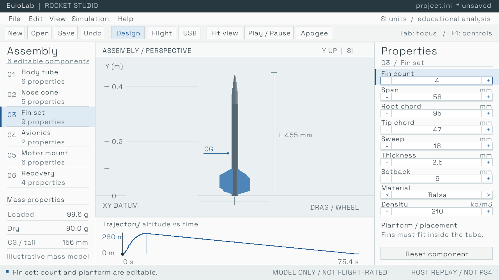

# EuloLab | استودیوی طراحی موشک مدل برای PS4

**خود برنامه در این مخزن است.** یک workbench بومیِ C++ برای انتخاب قطعات، ویرایش ۳۲ ویژگی پارامتریک، دیدن مدل سه‌بعدی و مرکز جرم، و بررسی یک شبیه‌سازی **آموزشی** پرواز. نوار منو، درخت مونتاژ، نمای فنی، inspector، نمودار و کنترل‌های ذخیره/بازکردن/بازپخش واقعاً به مدل متصل‌اند. ظاهر آن شبیه ابزارهای حرفه‌ای دسکتاپ طراحی شده است؛ **فایل اجرایی Windows جزو این نسخه نیست**. لایهٔ PS4 مستقیماً از APIهای Orbis برای تصویر، دسته و کشف USB استفاده می‌کند.

> **مرز تأیید:** آزمون هسته، رابط، ورودی و خروجی تصویری روی میزبان اجرا می‌شوند. گردش [GitHub Actions](.github/workflows/build.yml) با OpenOrbis یک ELF/eboot و یک **PKG خانگیِ آزمایش‌نشده روی کنسول** می‌سازد و محتوای بسته را بازاستخراج و بررسی می‌کند. این **اثبات نصب یا اجرای PS4 نیست**؛ ورودی دسته، عملکرد تصویر/ذخیره و رفتار USB روی سخت‌افزار و فریم‌ور هدف هنوز نیازمند آزمون‌اند. نتیجهٔ مدل پیش‌بینی ایمنی یا مجوز پرتاب نیست. عکس‌ها و ویدئو از اجرای میزبان‌اند، نه PS4 یا پرتاب فیزیکی.

## برنامه را همین حالا ببینید

```bash
make -j2 all test
make preview                       # لایهٔ نازک نمایش/ورودی در درگاه 8000
# یا: ./out/eulolab-host --screenshot out/assembly.ppm 22
```

در `make preview` مرورگر تنها **پیکسل‌های framebuffer برنامهٔ C++ واقعی** را نشان می‌دهد و رویداد موس/صفحه‌کلید را به همان برنامه می‌فرستد؛ فیزیک یا رابط در JavaScript بازنویسی نشده‌اند. در محیط Arena پیش‌نمایش زنده از پردازش اجراشده قابل‌دیدن است. در اجرای محلی آدرس `http://localhost:8000` را باز کنید. ابتدا روی صفحه کلیک کنید تا فوکوس بگیرد؛ برای خروج از فوکوس canvas کلید `F2` را بزنید. این پیش‌نمایشِ میزبان جای اجرای PS4 را نمی‌گیرد.

### کنترل‌ها

| ورودی | عملکرد |
| --- | --- |
| موس در میزبان | کلیک روی قطعه/مقدار؛ `-`/`+` برای گام‌بندی؛ کشیدن در viewport برای چرخش؛ چرخ موس برای zoom؛ کلیک/کشیدن روی نمودار برای جابه‌جایی زمان |
| صفحه‌کلید میزبان | `Tab`/`Shift+Tab` جابه‌جایی فوکوس، جهت‌ها حرکت/تغییر مقدار، `Enter` ویرایش یا تأیید، `Esc` انصراف، `Alt` منو، `F1` راهنما، `1` تا `6` انتخاب قطعه |
| میان‌برها | `Ctrl+S` ذخیره، `Ctrl+O` بازکردن، `Ctrl+N` پروژهٔ جدید، `Ctrl+Z` بازگشت آخرین تغییر؛ ویرایش عددی با تایپ و Enter، محدودیت نامعتبر با پیام خطا |
| دستهٔ PS4 | `L1/R1` جزء، `L2/R2` ناحیهٔ فوکوس، D-pad انتخاب/تغییر، `×` تأیید یا یک گام، `○` بازگشت، `□` ذخیره، `Options` منو، `△` صفحهٔ USB، `R3` تنظیم نمای مدل، دستهٔ راست چرخش |

روی PS4 ویرایش عددی با گام‌بندی انجام می‌شود؛ **صفحه‌کلید یا صفحهٔ ورود متنِ Orbis پیاده‌سازی نشده** و دسته هیچ فیلد تایپِ بی‌استفاده‌ای باز نمی‌کند. تغییرات ذخیره‌نشده پیش از «پروژهٔ جدید» یا بازکردن پروژهٔ دیگر، پنجرهٔ انصراف/ذخیره/دورریزی دارند.

## نمایش واقعی برنامه روی میزبان

[تماشای بازپخش MP4](video/eulolab-host-replay.mp4) (۷۹ ثانیه، ۱۲ فریم/ثانیه): سناریوی قطعیِ اجرای برنامهٔ میزبان؛ مونتاژ، جنس، دماغه، بالک، جرم اویونیک، انتخاب دادهٔ موتور تجاری، چتر و نمودار/بازپخش پرواز را نشان می‌دهد. هر فریم **HOST REPLAY / NOT PS4** دارد؛ ۱۹۰ ثانیهٔ محاسبه‌شدهٔ پرواز برای نمایش ویدئویی فشرده شده است. این ویدئو از اجرای واقعی رابط C++ به‌دست می‌آید، اما **سناریو خودکار است**؛ آزمون کلیک‌کردن کنترل‌ها جداگانه در `tests/ui_tests.cpp` و `tests/host_preview_test.py` انجام می‌شود.




برای بازتولید تصاویر و ویدئو:

```bash
./out/eulolab-host --screenshot out/assembly.ppm 22
./out/eulolab-host --screenshot out/descent.ppm 65
make video  # به ffmpeg/libx264 یا python3 -m pip install imageio-ffmpeg نیاز دارد
```

## قابلیت‌ها و محدودیت‌ها

| بخش | آنچه واقعاً وجود دارد | مرز مدل |
| --- | --- | --- |
| مونتاژ | شش جزء و ۳۲ ویژگی قابل‌ویرایش: بدنه/ماده/درگ، پوسته و پروفیل دماغه، تعداد/پلانفرم/جنس بالک، جرم و محل اویونیک، موتور/بوش داخلی و چتر/جرم/درگ؛ کنترل‌های وابستگی هندسی، undo و reset | قطعات نمونهٔ CAD صنعتی یا تحلیل تنش نیستند؛ چگالی‌ها مثال آموزشی‌اند |
| جرم و هندسه | پوستهٔ بدنه و دماغه، جرم بالک/بوش/موتور/چتر، CG از دم، مش پارامتریکِ قابل‌چرخش و علامت محل داخلی بوش | مدل جرم و مش تقریب‌اند؛ بررسی مرکز فشار یا پایداری وجود ندارد |
| پرواز | مدل عمودی یک‌بعدی با RK4 و گام ۱۰ ms، چگالی نمایی، رانش دادهٔ منتشرشدهٔ `.eng`، Cdهای قابل‌تنظیم، نمونه‌های زمانی و نمودار قابل‌جابجایی | بدون باد، زاویه، ۶-DoF، دادهٔ آزمایشگاهی آیرودینامیک یا اعتبارسنجی پرواز |
| بازیابی | چتر ایده‌آل در اوج و سرعت مدل‌شدهٔ پیش از برخورد؛ امکان خاموش‌کردن چتر | تأخیر، شکست، شوک یا بازشدن تدریجی و احتمال موفقیت مدل نشده‌اند |
| USB | فقط کشف descriptor دستگاه‌های احتمالی در لایهٔ PS4؛ صفحهٔ وضعیت/empty state | **هیچ byte دریافت، decoder، telemetry یا فرمان پرواز وجود ندارد**؛ عملکرد روی کنسول آزموده نشده |
| فایل پروژه | ذخیرهٔ `EULOROCKET3` (با نوشتن موقت و rename)، خواندن V1/V2/V3؛ میزبان `out/project.ini`، PS4 `/data/eulolab/project.ini` | دسترسی مسیر ذخیره روی PS4 آزموده نشده؛ روی میزبان کار می‌کند |

[منحنی‌های `.eng` موتورهای تجاری Klima C6 و D9](assets/motors/README.md) دادهٔ منتشرشدهٔ سازنده‌اند که Leo Nutz برای OpenRocket در مالکیت عمومی ارائه کرده است. برنامه سازندهٔ موتور/سوخت نیست و دادهٔ موتور **خواندنی** است؛ انتخاب منحنی از فهرست انجام می‌شود. ضرایب، جرم مواد و نحوهٔ بازشدن چتر مقادیر/فرض‌های آموزشی هستند. پیش از فعالیت واقعی از قوانین محلی، دادهٔ سازنده و متخصص مستقل استفاده کنید.

## ساخت بومی PS4 و بستهٔ آزمون‌نشده روی کنسول

1. [OpenOrbis PS4 Toolchain v0.5.4](https://github.com/OpenOrbis/OpenOrbis-PS4-Toolchain/releases/tag/v0.5.4) را با Clang/LLD 18 روی میزبان Linux آماده کنید. SDK و کد آن در مخزن بازنشر نمی‌شود؛ آرشیو رسمی در CI با SHA-256 سنجاق‌شده بررسی می‌شود.
2. مسیر SDK استخراج‌شده را مشخص کنید و بسازید:

```bash
export OO_PS4_TOOLCHAIN=/path/to/extracted/OpenOrbis-PS4-Toolchain
make ps4
# out/ps4/eulolab.elf
# out/ps4/eboot.bin
# out/ps4/stage/IV0000-BREW00242_00-EULOROCKETLAB001.pkg
```

`ps4/Makefile` از `clang++`، `ld.lld`، `create-fself`، `create-gp4` و `PkgTool.Core` استفاده می‌کند. ابزار قدیمی بسته‌بندی به OpenSSL 1.1 **روی میزبان بیلد** نیاز دارد؛ CI منبع نسخهٔ سنجاق‌شده را ایزوله می‌سازد، نه اینکه آن را در PKG بگذارد. در بیلد محلی کتابخانهٔ سازگار را تنها در `LD_LIBRARY_PATH` ابزار بسته‌بندی قرار دهید. [گردش CI](https://github.com/mobjakdebug/eulolab/actions/workflows/build.yml) یک artifact با نام `eulolab-ps4-homebrew-pkg-untested` و گزارش‌های `package.sha256`، `package-content.txt`، `package-validation.txt` و فرادادهٔ بسته بارگذاری می‌کند (اگر job موفق شود). هش ZIP گیت‌هاب با هش **خود PKG** فرق دارد. بازاستخراج و تطبیق فایل‌ها، امضای رسمی سونی یا اجرای سخت‌افزار را اثبات نمی‌کند.

## طراحی، آزمون و مجوز

- [`DESIGN.md`](DESIGN.md) تصمیم‌های workbench و اجرای **حین توسعه**ٔ anti-slop؛ [`docs/workbench-audit.md`](docs/workbench-audit.md) گزارش Delivery Gate با شواهد تعامل، ساخت و خطاها.
- [`src/core`](src/core) مدل/فایل/منحنی/پرواز؛ [`src/ui`](src/ui) rasterizer و رابط مشترک؛ [`src/platform/ps4.cpp`](src/platform/ps4.cpp) خروجی/ورودی بومی Orbis؛ [`src/platform/host.cpp`](src/platform/host.cpp) اجرای میزبان؛ [`tools/host_preview.py`](tools/host_preview.py) فقط انتقال تصویر و رویداد.
- `make -j2 all test` آزمون هسته، تمام ۳۲ فیلد inspector، مسیرهای منو/نوار ابزار/خطا/کیبورد/دسته، رندر و guard pixels و round-trip HTTP به کد C++ را اجرا می‌کند. خروجی میزبان **تأیید نمایش یا عملکرد روی PS4 نیست**.
- فونت [Space Grotesk](https://github.com/google/fonts/tree/main/ofl/spacegrotesk) با [SIL OFL](assets/OFL.txt) در assets است. منحنی‌های موتور [Public Domain](assets/motors/README.md) هستند؛ کد GPL برنامهٔ OpenRocket کپی نشده است. کد EuloLab تحت [MIT](LICENSE) است.

**English:** EuloLab is a native-Orbis C++ educational model-rocket workbench with 32 wired component properties and a thin, interactive host framebuffer preview. The host replay and stills are actual host output, **not console footage**. CI builds and inspects a homebrew PKG candidate, but console installation, execution and flight-safety predictions remain unverified.
