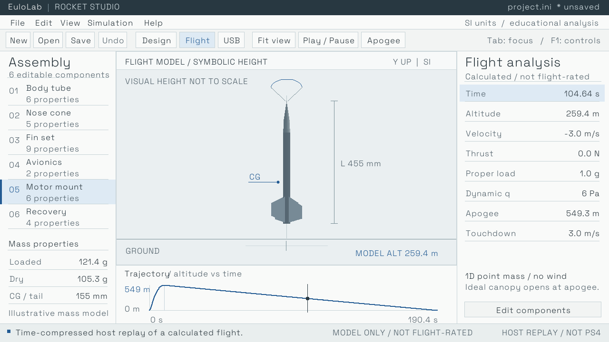

# EuloLab — استودیوی بومی طراحی موشک مدل برای PS4

**نسخهٔ اولیهٔ قابل‌ساخت از کد C++**: طراحی پارامتریک بدنه/دماغه/باله‌ها، جرم و مرکز جرم، انتخاب دادهٔ منتشرشدهٔ موتور تجاری، شبیه‌سازی آموزشی پرواز و نمایش مش سه‌بعدی با رندر نرم‌افزاری. برنامهٔ هدف مستقیماً از APIهای **Orbis OS** استفاده می‌کند؛ نه وب‌اپ است و نه برنامهٔ لینوکسی که به کنسول منتقل شده باشد. هسته و رابط مشترک روی میزبان هم برای آزمون و ضبط بازپخش ساخته می‌شوند.

> **وضعیت را دقیق بخوانید:** آزمون هسته و رندر رابط روی میزبان اجرا شده است. [اجرای موفق CI برای commit `32286eb`](https://github.com/mobjakdebug/eulolab/actions/runs/44745852305) با SDK OpenOrbis، ELF و eboot بومی و یک **PKG آزمایش‌نشده روی کنسول** ساخت و artifact آن را بارگذاری کرد. `PkgTool.Core` در CI بسته را خواند و هیچ هش/امضای نامعتبر گزارش نکرد؛ بازاستخراج آن شش فایل PFS و آیکون را با ورودی‌های بیلد برابر یافت و هویت `param.sfo` را بررسی کرد (۹ فایل شامل `keystone` تولیدشدهٔ ابزار). این آزمون بسته‌بندی جای آزمایش اجرای Orbis نیست. **نصب/اجرای PKG روی سخت‌افزار PS4، دسترسی USB، ذخیره‌سازی و نرخ فریم روی کنسول هنوز تأیید نشده‌اند.** این نرم‌افزار مرجع طراحی/ایمنی پرواز نیست. هیچ ویدئویی از PS4 یا پرتاب واقعی در این مخزن ادعا نمی‌شود.

## بازپخش تصویریِ خود برنامه

[🎬 تماشای `video/eulolab-host-replay.mp4`](video/eulolab-host-replay.mp4) — تصویربرداری از **اجرای واقعی همان کد C++ رابط و فیزیک روی میزبان**؛ سناریوی خودکار، ایجاد پروژه، تغییر ماده و ابعاد دماغه و باله، تعیین جرم اویونیک، انتخاب دادهٔ تجاری Klima D9، برآورد چتر، پرواز شبیه‌سازی‌شده و صفحهٔ ایستگاه زمینی را نمایش می‌دهد. هر فریم با **HOST REPLAY** مشخص شده است؛ زمان پرواز برای نمایش کامل، فشرده شده است. این نه ویدئوی اجرا روی PS4 است، نه فیلم ساخت فیزیکی موشک/پرتاب.

تصاویر همان اجرای میزبان (نه اسکرین‌شات PS4):




| بخش | پیاده‌سازی حاضر | محدودیت |
| --- | --- | --- |
| بدنهٔ بومی PS4 | `src/platform/ps4.cpp`: `sceVideoOut`، framebuffer مستقیم دوگانه، `scePad`، `sceUserService`، `sceUsbd` | اجرا و نمایش روی کنسول هنوز آزموده نشده |
| کارگاه مونتاژ | بدنه، طول مخروط، سه باله، جرم اویونیک، ماده، موتور، قطر چتر؛ ذخیره/بارگذاری پروژهٔ محلی | مش برای نمایش است، مدل CAD تولید/تحلیل سازه‌ای نیست |
| مدل پرواز | دینامیک عمودی نقطه‌ای، RK4 با گام ۱۰ ms، رانش خطی `.eng`، جرم کاهنده، چگالی نمایی، درگ وابسته به سرعت | بدون باد، ۶-DoF، مرکز فشار، پایداری، شوک بازشدن چتر یا اعتبارسنجی پرواز |
| بازیابی | چتر ایده‌آل در اوج، برآورد سرعت پیش از برخورد | تأخیر، شکست، بازشدن تدریجی و روش واقعی استقرار مدل نشده‌اند |
| ایستگاه زمینی | کشف descriptor برخی دستگاه‌های USB سریال روی PS4، **صرفاً خواندنی** | هیچ دادهٔ تله‌متری دریافت/تفسیر نمی‌شود؛ USB روی کنسول آزموده نشده |
| رابط سه‌بعدی | مش پارامتریک سطح بدنه/مخروط/باله، نورپردازی رنگی، مرتب‌سازی چهره‌ها و نمای پرواز | رندر نرم‌افزاری؛ هنوز موتور GPU یا نمایش CAD صنعتی نیست |

### دادهٔ موتور و دامنهٔ ایمنی

[منحنی‌های `.eng` موتورهای تجاری Klima C6 و D9](assets/motors/README.md) دادهٔ سازنده هستند که Leo Nutz برای OpenRocket منتشر و در مالکیت عمومی قرار داده است. موتور یا مواد پیشران در این پروژه تولید/آماده نمی‌شوند. جرم پوسته و باله، ضرایب درگ، استقرار چتر و مصرف جرم پیشران **تخمین آموزشی** هستند؛ اعداد اوج، شتاب و سرعت فرود پیش‌بینی ایمن یا مجوز پرواز نیستند. قبل از هر فعالیت واقعی، قوانین محلی و دستورالعمل مستقل سازنده و متخصص واجد صلاحیت لازم است.

## اجرای آزمون و تصویربرداری میزبان (فقط ابزار توسعه)

نیازمند `g++` با C++17 و `make`:

```bash
make -j2 all test
./out/eulolab-host --screenshot out/assembly.ppm 42
./out/eulolab-host --screenshot out/descent.ppm 60
```

برای بازتولید MP4: `ffmpeg` با encoder `libx264` یا `python3 -m pip install imageio-ffmpeg` لازم است:

```bash
make video
# خروجی: video/eulolab-host-replay.mp4، 1280x720، 12 fps، 79 ثانیه
```

میزبان فقط ابزار CLI رندر و آزمون است؛ محصول تعاملی هدف **PS4** است و نسخهٔ دسکتاپ/لینوکس در این مرحله ارائه نشده. واحدهای فیزیک SI هستند.

## ساخت بومی PS4 (OpenOrbis)

1. [OpenOrbis PS4 Toolchain v0.5.4](https://github.com/OpenOrbis/OpenOrbis-PS4-Toolchain/releases/tag/v0.5.4) را نصب کنید؛ برای Linux به Clang/LLD 18 نیاز است. مخزن، باینری SDK را نگه نمی‌دارد. گردش CI آرشیو منتشرشده را با SHA-256 سنجاق‌شده بررسی می‌کند.
2. مسیر ریشهٔ SDK استخراج‌شده را مشخص کنید و ساخت را اجرا کنید:

```bash
export OO_PS4_TOOLCHAIN=/path/to/extracted/OpenOrbis-PS4-Toolchain
make ps4
# out/ps4/eulolab.elf
# out/ps4/eboot.bin
# out/ps4/stage/IV0000-BREW00242_00-EULOROCKETLAB001.pkg
```

`ps4/Makefile` مطابق نمونه‌های OpenOrbis از `clang++`، `ld.lld`، `create-fself`، `create-gp4` و `PkgTool.Core` استفاده می‌کند. `PkgTool.Core` قدیمی به OpenSSL 1.1 در **میزبان بیلد** نیاز دارد؛ CI نسخهٔ منبعِ سنجاق‌شده را به‌صورت ایزوله می‌سازد (نه در سیستم نصب می‌کند و نه داخل PKG می‌گذارد). در بیلد محلی، کتابخانهٔ سازگار را فقط برای ابزار بسته‌بندی از طریق `LD_LIBRARY_PATH` فراهم کنید. [GitHub Actions](.github/workflows/build.yml) هم آزمون‌های میزبان را اجرا می‌کند و هم ELF/eboot/PKG بومی را می‌سازد؛ در اجرای موفق، artifact با نام `eulolab-ps4-homebrew-pkg-untested` در [صفحهٔ workflow](https://github.com/mobjakdebug/eulolab/actions/workflows/build.yml) منتشر می‌شود. این آرشیو علاوه بر `.pkg`، فایل‌های `package.sha256`، `package-content.txt` (فهرست و هش فایل‌های استخراج‌شده)، `package-validation.txt` و گزارش فرادادهٔ بسته را دارد. `sha256sum -c package.sha256` را در کنار PKG استخراج‌شده از artifact اجرا کنید؛ هش ZIPِ گزارش‌شده توسط گیت‌هاب با هش خود PKG متفاوت است. اعتبارسنجی LibOrbisPkg و مقایسهٔ فایل‌های استخراج‌شده **فقط آزمون ساخت بسته** هستند. اجرای شبیه‌ساز Orbis یا امضای رسمی سونی در این مخزن انجام نمی‌شود. نصب فقط در محیط‌های مجاز/سازگار با ابزار توسعهٔ خودتان قابل بررسی است.

### کنترل دستهٔ PS4

| کنترل | عملکرد |
| --- | --- |
| `×` | پروژهٔ جدید / ورود به شبیه‌سازی / توقف و ادامهٔ پخش |
| `○` | بازگشت |
| `L1 / R1` | جزء قبلی / بعدی در گاراژ |
| `↑ / ↓` | فیلد قبلی / بعدی |
| `← / →` | تغییر فیلد؛ در صفحهٔ پرواز جابه‌جایی زمان |
| `□` | ذخیرهٔ فایل پروژه در `/data/eulolab/project.ini` |
| دستهٔ راست | چرخش و زاویهٔ دید مش سه‌بعدی |
| `Options` | بارگذاری فایل پروژه (فرمت V2 و سازگاری خواندن V1) |
| `△` | ایستگاه زمینی / بازگشت به گاراژ |

## ساختار و منابع بازمتن

- [`src/core`](src/core): هندسه/جرم، تجزیهٔ RASP، مدل پرواز و فایل پروژه؛ [`tests`](tests): آزمون‌های هسته و جریان رابط.
- [`src/ui`](src/ui): rasterizer و مش مشترک که همان خروجی را در میزبان و backend PS4 رندر می‌کند. [`src/platform/ps4.cpp`](src/platform/ps4.cpp): ورودی و خروجی بومی Orbis؛ [`src/platform/host.cpp`](src/platform/host.cpp): ضبط و تست میزبان.
- الگوی استفاده از `sceVideoOut`، حافظهٔ مستقیم و ابزارهای PKG از [نمونهٔ رسمی OpenOrbis graphics](https://github.com/OpenOrbis/OpenOrbis-PS4-Toolchain/tree/master/samples/graphics) مطالعه شده است؛ باینری SDK و کد شخص ثالثِ OpenOrbis در این مخزن کپی نشده‌اند.
- فونت [Space Grotesk](https://github.com/google/fonts/tree/main/ofl/spacegrotesk) از Google Fonts با [مجوز SIL OFL](assets/OFL.txt) در دارایی‌ها است. منحنی‌های موتور [OpenRocket](assets/motors/README.md) **Public Domain** هستند؛ کد GPL برنامهٔ OpenRocket وارد این پروژه نشده است.
- [JSBSim](https://github.com/JSBSim-Team/jsbsim)، [Bullet](https://github.com/bulletphysics/bullet3) و [OpenGNM](https://github.com/PS4-OpenGNM/opengnm) برای مراحل بعدی مطالعه شدند و **فعلاً ادغام نشده‌اند**. کد این مخزن تحت [MIT](LICENSE) است؛ مجوز دارایی‌ها جداگانه حفظ شده است.

**English:** EuloLab is an early native-Orbis C++ model-rocket design/simulation prototype. The MP4 is a scripted capture of the *actual shared application running on a host*, clearly marked HOST REPLAY; **not PS4 footage or physical launch footage**. CI cross-compiles the PS4 eboot, builds a homebrew PKG candidate, validates its digests and checks extracted contents; the PKG is available as a short-lived Actions artifact. **Console execution**, USB telemetry and flight-safety predictions have not been validated.
